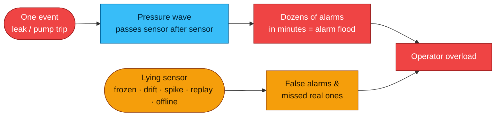
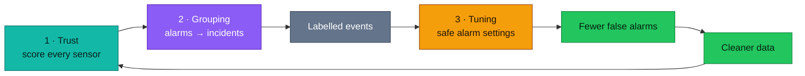
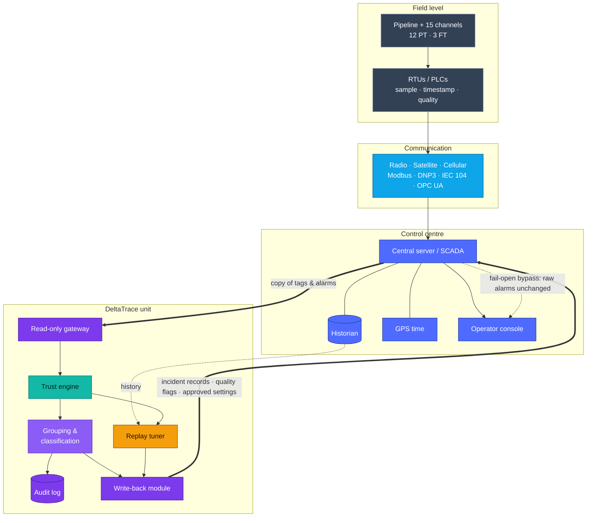
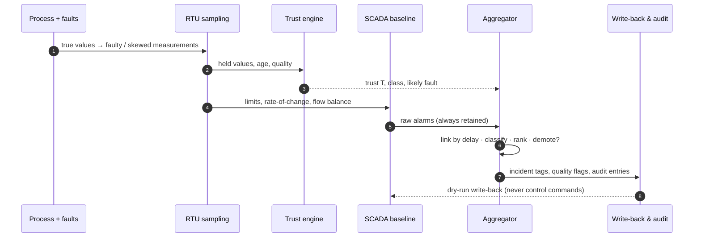
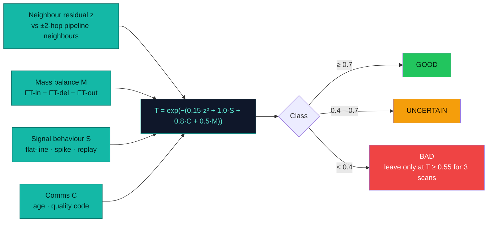
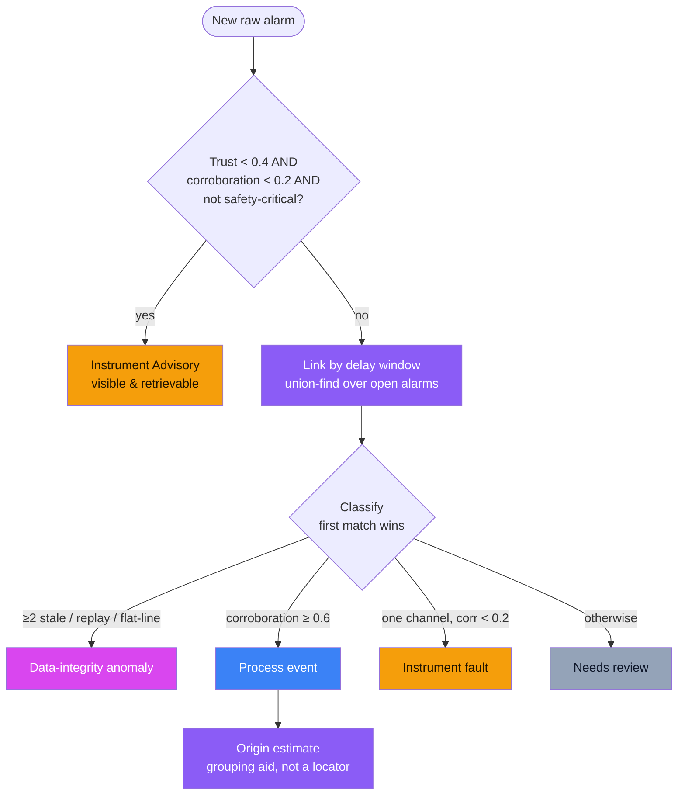
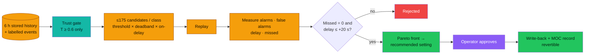

<div align="center">

#  DeltaTrace Live

### Fewer alarms. Clearer incidents. Safer settings.

An in-browser control-room application showing how a software layer reduces alarm floods on an oil and gas pipeline.


** Trust Engine &nbsp;·&nbsp;  Delay-Based Grouping &nbsp;·&nbsp;  Trust-Gated Replay Tuner**

</div>

---

## Contents

1. [The problem](#the-problem) · 2. [The idea](#the-idea) · 3. [Architecture](#architecture) · 4. [The three innovations](#the-three-innovations) · 5. [Safety rules](#safety-rules) · 6. [Pages](#pages) · 7. [Quick start](#quick-start) · 8. [Demo script](#the-7-minute-demo) · 9. [Shortcuts](#keyboard-shortcuts) · 10. [Results](#results) · 11. [Assumptions](#assumptions) · 12. [Limits](#honest-limitations) · 13. [Project layout](#project-layout)

---

## The problem

A 200 km pipeline is watched by sensors about every 20 km. The existing control system (SCADA) raises an alarm whenever a reading crosses a limit. Two things go wrong:



## The idea

**DeltaTrace** sits *beside* the existing system (read-only in, controlled write-back out) and adds three connected innovations. Together they form a **closed loop**:



## Architecture



### Data flow per 5-second scan



## The three innovations

### 1 · Trust Engine

Every channel gets a live score from four checks:



A real transient seen by several neighbours **widens the tolerance** instead of punishing healthy sensors.

### 2 · Delay-Based Incident Grouping

Two alarms join one incident if `hops ≤ 3` **and** `|Δt| ≤ distance ÷ wave speed + clock tolerance + scan interval`.
Example: 20 km ÷ 1000 m/s = **20 s** (+10 s). Two simultaneous alarms 150 km apart are **not** merged.



Score `S = Σ severity · Tᵝ · (1 + γ·Corr)` ranks incidents; safety-critical alarms always lead the headline.

### 3 · Trust-Gated Replay Tuner



Objective: `J = 1·alarms + 2·falseAlarms + 0.05·meanDelay + 1e6·missed`. Turning trust gating **off** lets faulty-sensor samples contaminate the replay and can produce a worse recommendation.

## Safety rules

Enforced in code, checked live in the UI, covered by tests.

| # | Rule |
|---|---|
| 1 | Safety-critical alarms are **never hidden**; they lead the incident headline. |
| 2 | Low trust alone **never silently deletes** an alarm; it becomes a visible Instrument Advisory. |
| 3 | A **corroborated** alarm is never demoted because one source has low trust. |
| 4 | **Every raw alarm is retained** and linked to its incident or advisory. |
| 5 | **Fail-open:** engine OFF ⇒ raw alarms pass through unchanged. |
| 6 | DeltaTrace **never issues control commands** (only incident records, quality flags, operator-approved parameters; dry-run here). |

## Pages

| Page | What it shows |
|---|---|
| **Overview** | Hero, three innovation cards with live numbers, before/after tickers, loop diagram, safety rules |
| **Live Console** | Animated pipeline, raw-alarm view vs DeltaTrace view, flood gauge, strip charts, explain overlay, replay last 5 min |
| **Incidents** | Filter/sort, class reasoning, position-time timeline with wavefront, member alarms, origin, dispositions |
| **Trust Center** | Trust heatmap, sensor cards, predicted-vs-measured, neighbour graph, live formula, quick faults |
| **Alarm Tuner** | Run replay, Pareto chart, gated vs contaminated, approve & write back, MOC change log, loop iterations |
| **Write-back & Audit** | Dry-run tag feed, audit log, live rule compliance, CSV/JSON export |
| **Benchmarks** | Scenarios S0–S8 × N seeds, charts, confusion matrix, experiments E1–E7, exports |
| **Guided Demo** | 10-step narrated story with auto fault injection and presenter mode |
| **How It Works** | 12 interactive sections driven by live data, with text alternatives |
| **Settings** | Wave speed, tolerances, trust weights, thresholds, demotion rules, seed, theme |

## Quick start

```bash
npm i
npm run dev          # http://localhost:5173
npm test             # 51 tests: engine, safety, scenarios, tuner, persistence, UI smoke
npm run typecheck
npm run lint
npm run build        # → dist/
npm run preview
```

Requires Node 18+. No backend, no accounts, no analytics, no external fonts/CDNs. Works offline.

### ▲ Deploy to Vercel
Import the repo → framework preset **Vite** → build `npm run build` → output `dist`. `vercel.json` already has the SPA rewrite and immutable asset caching.

## The 7-minute demo

```mermaid
flowchart LR
  s1[1 Normal]:::a --> s2[2 Pump trip<br/>flood]:::b --> s3[3 Grouping<br/>not merged]:::c --> s4[4 Leak km 87]:::c --> s5[5 Stuck PT-7]:::d --> s6[6 Replay + valve]:::d --> s7[7 Comms + leak]:::c --> s8[8 Tuning]:::e --> s9[9 Fail-open]:::b --> s10[10 Close loop]:::a
  classDef a fill:#22c55e,color:#04210f
  classDef b fill:#ef4444,color:#fff
  classDef c fill:#8b5cf6,color:#fff
  classDef d fill:#14b8a6,color:#03201d
  classDef e fill:#f59e0b,color:#1f1300
```



Open **Guided Demo → Start**. Auto-play, skip/back, presenter mode (`P`) and emergency reset (`R`) are built in.

## ⌨ Keyboard shortcuts

| Key | Action |
|---|---|
| `Space` | Play / pause |
| `F` | Fault injector |
| `1`–`9` | Quick faults: pump trip · leak km 87 · freeze PT-7 · replay PT-3 · false injection PT-9 · comms outage · comms + leak · valve closure · batch interface |
| `Ctrl/Cmd + K` | Command palette |
| `P` | Presenter mode |
| `R` | Emergency reset (presenter / demo) |
| `?` | Shortcut help |

## Results

5 seeds each, headless, 30-minute timelines:

| Scenario | Peak alarms / 10 min | % time in flood | Operator items | Critical hidden |
|---|---|---|---|---|
| S1 Pump trip cascade | 52.8 → **1.0** | 37% → 0% | 53 → 1.0 | **0** |
| S2 Small leak | 16.8 → **1.0** | 33% → 0% | 17 → 1.2 | **0** |
| S4 Spoofed transmitter | 28.0 → **2.0** | 35% → 0% | 28 → 2.0 | **0** |
| S6 Comms outage + leak | 15.0 → **2.0** | 32% → 0% | 15 → 2.0 | **0** |
| S8 Mixed stress | 80.4 → **2.8** | 52% → 0% | 82 → 3.0 | **0** |

Class accuracy 100% on matched incidents; leak origin within ±6 km. Run **Benchmarks** in the app for the full S0–S8 table and experiments E1–E7.

## Assumptions

- Built at the repo root (no nested folder). Recharts is not used; all charts are hand-written SVG/canvas.
- **Baseline floods by design:** transients include water-hammer ringing (amp 0.9, period 12 s, decay 40 s) and leak amplitudes are 1.6× the spec's starting values (1.0 / 2.4 / 4.8 bar).
- Flow lag = distance ÷ 1.2 m/s clipped to 90 s so it is visible in a demo.
- The "existing system" also raises *no-change* and *communications* alarms, otherwise frozen/dead sensors would be silent.
- Replay detection emits a DeltaTrace-derived `DQ` alarm (not counted as raw) that opens a data-integrity incident.
- Operator items = incidents opened + advisories created (+ pass-through alarms when the engine is off).
- Default clock tolerance 5 s, scan 5 s ⇒ link window = delay + 10 s.
- Tuner: 6 h seeded training history (8 labelled events, many sensor faults), generated once (~1.5 s) and cached; recommendations must miss no event the current setting catches, add ≤ 20 s delay and not raise alarm load.

## Honest limitations

- Trust weights and thresholds are defaults and require calibration for a specific line.
- **Wave speed must be known or estimated;** a wrong value shifts every delay window.
- **The origin estimate is a grouping aid, not a leak locator.**
- **Overlapping events merge** when they coincide in time and place (e.g. S8 trip + nearby leak; two medium leaks whose wave tails overlap).
- **Quiet scenarios** (S0, S7) give DeltaTrace nothing to reduce; S7 still yields one false incident.
- **Clock skew** is tolerated only up to the configured tolerance (experiment E4).
- **Slow drift** is noticed only after the residual grows (~2 min).
- **Flow corroboration is coarse:** two moving pressure sensors anywhere count.
- **Tuner gating** clearly helped only the rate-of-change class on this history (experiment E5).
- Operator approval is always required for any setting change.

## Project layout

```text
PLAN.md · README.md · vercel.json · vite.config.ts
src/
  engine/      pure, seeded simulation + the 3 innovations (no React)
               rng · topology · process · faults · scada · trust · aggregator · classifier
               origin · tuner · metrics · scenarios · experiments · simulation
  state/       zustand stores · SimulationRunner tick loop · persistence
  components/  shell · ui kit · viz (SVG/canvas) · domain widgets
  pages/       Overview · Console · Incidents · Trust · Tuner · Writeback
               Benchmarks · Demo · HowItWorks · Settings
  styles/      tokens.css (light + dark) · base · shell · components · pages
tests/         vitest: engine, safety properties, scenarios, tuner, persistence, app smoke
```

---

