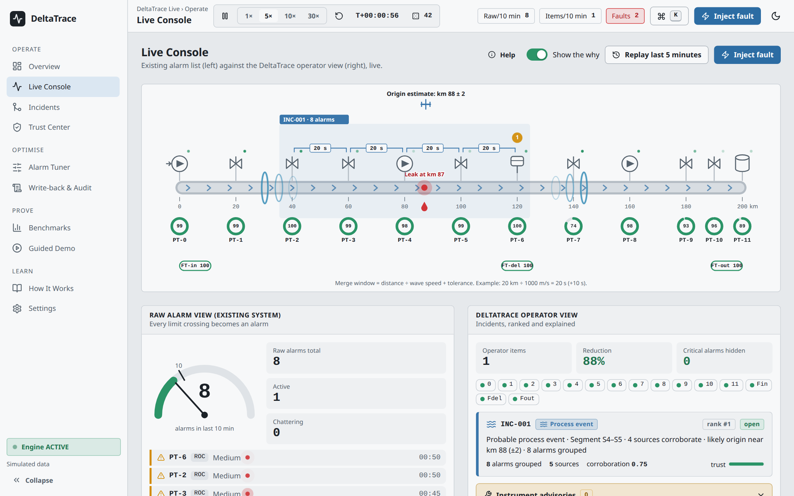
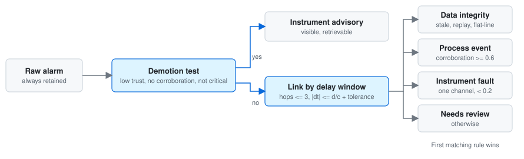
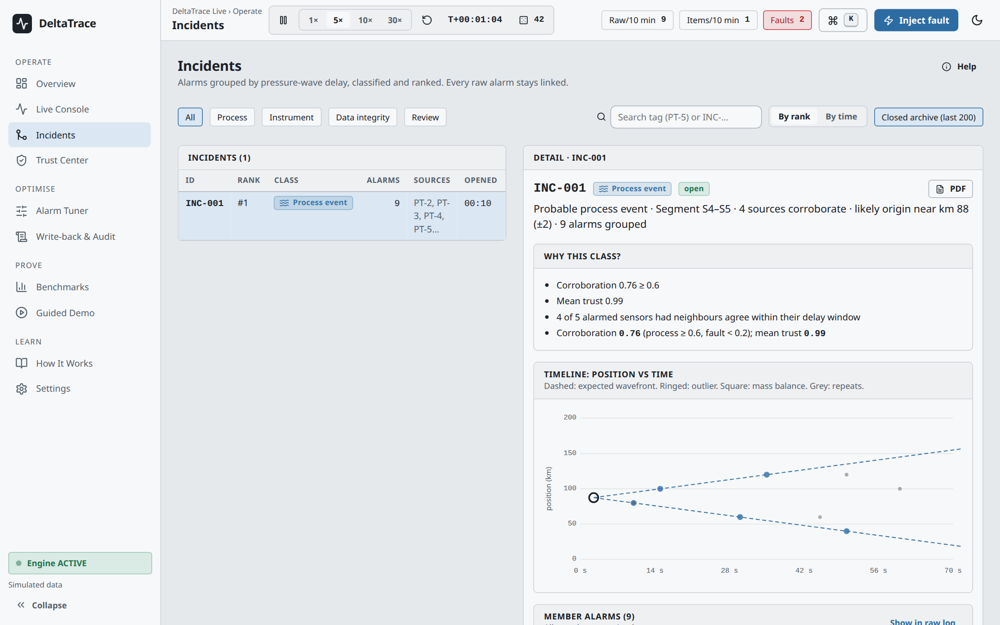
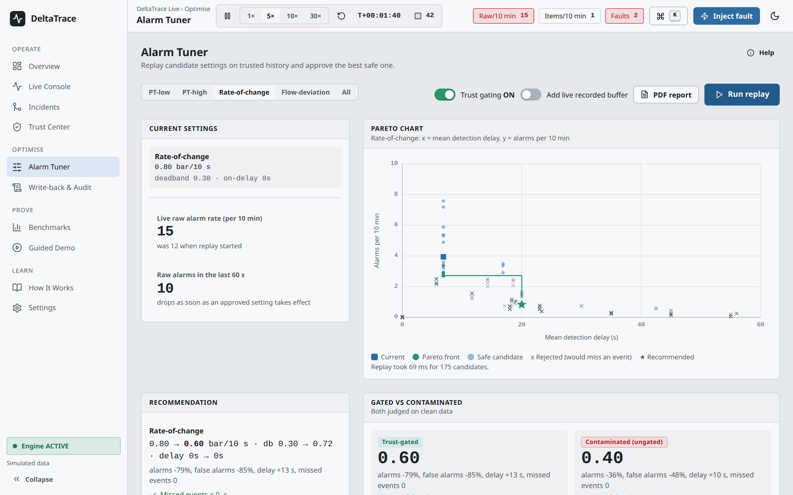
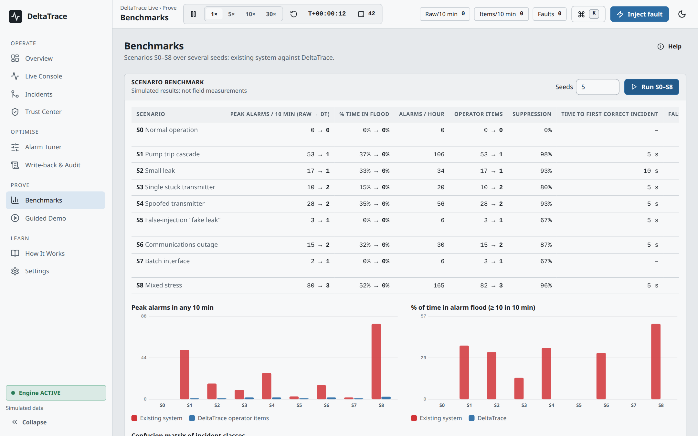

<div align="center">

# DeltaTrace Live

**Sensor trust, delay-based alarm grouping and safer alarm settings for pipeline control rooms.**

[](https://github.com/kiruthikpurpose/DeltaTrace/actions/workflows/ci.yml)
[](LICENSE)


</div>

<p align="center">
  
</p>

DeltaTrace sits beside an existing SCADA system. It reads sensor data and alarms, scores how far each sensor can be trusted, groups related alarms into single incidents, and proposes safer alarm settings. It writes back only incident records, data-quality flags and operator-approved parameters. It never issues control commands.

This repository is a complete browser application with a built-in process simulator, so every feature can be exercised without a plant connection.

## Contents

[Why](#why) · [Functions](#functions) · [Architecture](#architecture) · [Alarm decisions](#alarm-decisions) · [Safety rules](#safety-rules) · [Screens](#screens) · [Getting started](#getting-started) · [Testing and CI](#testing-and-ci) · [Deployment](#deployment) · [Reports](#reports) · [Project layout](#project-layout) · [Configuration](#configuration) · [Limitations](#limitations) · [Contributing](#contributing) · [License](#license)

## Why

A long pipeline is monitored by sensors every ~20 km, and the control system raises an alarm at every limit crossing. Two problems follow:

- **One event, many alarms.** A leak or pump trip sends a pressure wave past many sensors in turn, producing dozens of alarms within minutes.
- **Some alarms are not real.** Sensors freeze, drift, spike, replay old data, go offline or are tampered with, and hand-set alarm limits drift back toward flooding.

## Functions

| Function | What it does | Page |
|---|---|---|
| **Trust engine** | Scores every channel from 0 to 1 using neighbour agreement, mass balance, signal behaviour and communication health. | Trust Center |
| **Delay-based grouping** | Merges alarms whose time gaps fit the pressure-wave travel time between sensors, classifies the incident, ranks it and estimates an origin. | Live Console, Incidents |
| **Trust-gated replay tuner** | Replays candidate thresholds, deadbands and delays on stored data from trusted sensors only and recommends the best safe setting for approval. | Alarm Tuner |

The three feed each other: trust improves grouping, grouping produces labelled events, labelled events improve tuning, and tuning reduces false alarms, which cleans the data trust relies on.

## Architecture

<p align="center">
  <picture>
    <source media="(prefers-color-scheme: dark)" srcset="docs/images/architecture-dark.svg">
    
  </picture>
</p>

DeltaTrace is a read-only consumer of SCADA data. Its write-back module returns incident records, quality flags and approved settings to the SCADA server through a controlled interface. If DeltaTrace is switched off or fails, SCADA alarms reach the operator console unchanged (fail-open).

### Processing per scan

<p align="center">
  <picture>
    <source media="(prefers-color-scheme: dark)" srcset="docs/images/scan-flow-dark.svg">
    
  </picture>
</p>

## Alarm decisions

<p align="center">
  <picture>
    <source media="(prefers-color-scheme: dark)" srcset="docs/images/decision-flow-dark.svg">
    
  </picture>
</p>

| Class | Rule (first match wins) |
|---|---|
| Data integrity | Two or more channels stale or bad with a communications cause, or a replayed or flat-lined channel while neighbours change |
| Process event | Trust-weighted corroboration >= 0.6 |
| Instrument fault | One channel (or only low-trust channels) and corroboration < 0.2 |
| Needs review | Everything else |

Two alarms are linked when they are within 3 hops and their time difference is at most `distance / wave speed + clock tolerance + scan interval`. For example 20 km at 1000 m/s gives 20 s (plus 10 s). Comms and no-change alarms describe the instrument, so they only group with their own kind.

## Safety rules

Enforced in code, checked live in the UI and covered by `tests/safety.test.ts`.

1. Safety-critical alarms are never hidden and lead the incident headline.
2. Low trust alone never deletes an alarm; it becomes a visible, retrievable Instrument Advisory.
3. A corroborated alarm is never demoted because one source has low trust.
4. Every raw alarm is retained and linked to its incident or advisory.
5. With the engine off, raw alarms pass through unchanged.
6. No control commands are ever issued. Write-backs are limited to incident records, quality flags and operator-approved parameters, and are dry-run in this build.

## Screens

<table>
  <tr>
    <td width="50%"><br><sub>Incident detail: classification basis, position-time timeline, member alarms</sub></td>
    <td width="50%"><br><sub>Trust Center: heatmap, sensor cards, neighbour graph</sub></td>
  </tr>
  <tr>
    <td width="50%"><br><sub>Alarm Tuner: Pareto front of candidate settings</sub></td>
    <td width="50%"><br><sub>Benchmarks: scenarios S0 to S8, existing system against DeltaTrace</sub></td>
  </tr>
</table>

## Getting started

Requires Node 18 or newer.

```bash
git clone https://github.com/kiruthikpurpose/DeltaTrace.git
cd DeltaTrace
npm ci
npm run dev        # http://localhost:5173
```

Open **Guided Demo** for a ten-step walkthrough, or press `F` anywhere to inject a fault.

| Script | Purpose |
|---|---|
| `npm run dev` | Development server |
| `npm run build` | Typecheck and production build to `dist/` |
| `npm run preview` | Serve the production build |
| `npm test` | Run the test suite |
| `npm run typecheck` | TypeScript strict check |
| `npm run lint` | ESLint |
| `npm run check:bundle` | Fail if initial JavaScript exceeds 400 kB gzip |
| `npm run ci` | Everything CI runs, in order |
| `npm run diagrams` | Regenerate the README diagrams |

### Keyboard shortcuts

| Key | Action |
|---|---|
| `Space` | Play / pause |
| `F` | Fault injector |
| `1` to `9` | Quick faults (pump trip, leak, frozen sensor, replay, false injection, comms outage, comms plus leak, valve closure, batch interface) |
| `Ctrl/Cmd + K` | Command palette |
| `P` / `R` | Presenter mode / emergency reset |
| `?` | Shortcut help |

## Testing and CI

The suite has 52 tests: engine unit and property tests (trust, grouping, classification, origin, tuner, metrics), scenario tests S0 to S8, safety invariants across many seeds, persistence, and UI smoke tests.

GitHub Actions (`.github/workflows/ci.yml`) runs on every push to `main` and every pull request, on Node 18, 20 and 22:

`npm ci` → typecheck → lint → test → build → bundle budget check.

Run the same sequence locally with `npm run ci`.

## Deployment

The build is a static site.

- **Vercel:** import the repository, preset *Vite*, build command `npm run build`, output directory `dist`. `vercel.json` already contains the single-page-app rewrite and immutable asset caching.
- **Any static host:** serve `dist/` and rewrite unknown paths to `index.html`.

The application makes no network requests at runtime and works offline.

## Reports

PDF reports are generated in the browser, without a server or external library.

| Report | Where | Contents |
|---|---|---|
| Benchmark | Benchmarks | Summary, scenario table, charts, confusion matrix, experiments, method |
| Operations and audit | Write-back and Audit | KPIs, safety compliance, sensor trust, incidents, advisories, change records, audit trail, configuration |
| Incident | Incident detail | Summary, classification basis, origin, member alarms, write-back |
| Alarm tuning | Alarm Tuner | Recommendations, Pareto charts, candidate tables, contamination check |

## Project layout

```text
src/
  engine/       Pure TypeScript simulation and the three functions (no React, seeded RNG)
  state/        Zustand stores, the simulation runner, persistence
  components/   Shell, UI kit, SVG and canvas visuals, domain widgets
  pages/        One module per route
  styles/       Design tokens (light and dark) and component styles
  utils/        Formatting, PDF writer, report builders, accessibility helpers
tests/          Vitest suites
scripts/        Diagram generator, bundle-size check
docs/           README images and architecture notes
```

More detail: [docs/architecture.md](docs/architecture.md).

## Configuration

Defaults live in `src/engine/config.ts` and can be changed on the Settings page.

| Parameter | Default |
|---|---|
| Wave speed | 1000 m/s |
| Clock tolerance / scan interval | 5 s / 5 s |
| Hop limit | 3 |
| Trust weights (residual, signal, comms, balance) | 0.15 / 1.0 / 0.8 / 0.5 |
| Trust classes | GOOD >= 0.7, BAD < 0.4 |
| Process / fault corroboration | 0.6 / 0.2 |
| Demotion (trust, corroboration) | < 0.4 and < 0.2 |
| Incident quiet time | 120 s |

The simulation is reproducible: the same seed, configuration and injection timeline give the same run. The seed is shown in the top bar.

## Limitations

- Trust weights and thresholds are defaults and need calibration for a specific line.
- Wave speed must be known or estimated; a wrong value shifts every delay window.
- The origin estimate is a grouping aid, not a leak locator.
- Events that overlap in both time and place can merge into one incident.
- Where baseline alarm load is already low, there is little to reduce.
- Operator approval is always required before a setting change.

## Contributing

Contributions are welcome. Read [CONTRIBUTING.md](CONTRIBUTING.md) and the [Code of Conduct](CODE_OF_CONDUCT.md). Report vulnerabilities as described in [SECURITY.md](SECURITY.md). Changes are tracked in [CHANGELOG.md](CHANGELOG.md).

## License

Licensed under the [Apache License, Version 2.0](LICENSE). See [NOTICE](NOTICE).
